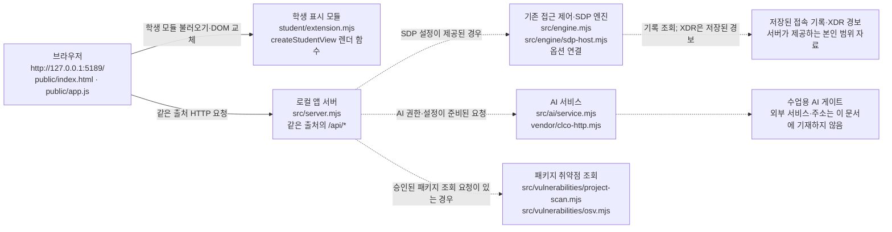

# PICASOAR 학생용 실행 설명서와 구성도

이 문서는 현재 제공된 `on-client` 프로젝트의 파일과 실행 계약을 기준으로 작성한 학생용 안내입니다. **초안 작성 당시에는 앱을 실행하거나 브라우저·AI·SDP·OSV 연결을 시험하지 않았습니다.** 이후 사용자가 제공한 실제 PC 확인 결과는 §6에 별도로 기록했습니다. 문서에 정리한 정적 코드 확인과 실제 PC 실행 결과를 구분합니다.

## 1. 프로젝트 목적과 범위

PICASOAR는 로그인 사용자·기기·세션, 업무 앱 접근 판정, 본인 범위의 접속 기록과 저장된 XDR 경보를 보여 주도록 구성된 보안 Agent 학생 프로젝트입니다. AI 설명은 근거를 바탕으로 한 참고 정보이며 판정이나 조치를 대신하지 않습니다. 기본 실행은 기존 회사 시스템에 연결되지 않을 수 있습니다. 예제 자료(`demo`)나 `disconnected`는 실제 연결·권한 확인이 아닙니다.

- 기본 제공 앱 이름은 기존 안내에 **케셰브(KESHEV)**로 적혀 있습니다. 여기서는 학생이 정한 Agent 이름인 **PICASOAR**를 설명서 제목에 사용합니다. 이름을 바꿔도 앱 제목이 자동으로 바뀐다고 가정하지 마세요.
- `on-client`는 앱 코드가 있는 폴더입니다. 전체 프로젝트의 Git 최상위 폴더는 안내상 `on-client`의 상위 프로젝트 폴더입니다.
- 학생 표시 구현은 `on-client/student/extension.mjs`에 두고, 제공 UI·서버·판정·인증 설정은 학생 구현과 구분합니다.

## 2. 지원 환경과 확인된 실행 계약

| 항목 | 프로젝트에서 확인한 값 | 범위와 주의 |
|---|---|---|
| Node.js | `package.json`의 `engines.node`는 `24.19.0` | 사용자가 보고한 PC 설치 버전은 `v24.21.0`이며 해당 버전에서 `npm.cmd start` 실행 성공을 확인했습니다. 프로젝트의 정확한 기준 버전과 설치 버전은 다릅니다. |
| npm | PC에서 확인한 `11.19.0` | 사용자가 제공한 실제 PC 확인 결과입니다. |
| 앱 패키지 | `alekov-client-starter`, 버전 `0.2.11`, `private: true` | `package.json` 기준입니다. |
| 실행 스크립트 | `npm start` → `node src/server.mjs`; `npm run demo` → `node src/server.mjs --demo` | `npm.cmd start`를 실제 실행했습니다. `npm run demo`는 예제 실행이며 실제 연결이 아닙니다. |
| 문법 확인 스크립트 | `npm run check` → `node --check student/extension.mjs` | JavaScript 문법만 확인하며 브라우저 동작·연결·과제 통과를 확인하지 않습니다. 이번 21단계 검증에서 실행하지 않았습니다. |
| npm 의존성 | `package.json`에 `dependencies`가 선언되어 있지 않음 | 현재 `package-lock.json`은 프로젝트 파일 목록에서 확인되지 않았습니다. 설치 단계가 필요하다고 추정해 `npm install`을 요구하지 않습니다. |
| 실행 도구 | `tools/start-alekov.ps1` 파일 존재 확인 | 스크립트의 실제 실행 성공 여부는 미확인입니다. Windows PowerShell 실행 절차는 `docs/STUDENT_LAUNCH_GUIDE.md`에도 있습니다. |
| 기본 주소 | `http://127.0.0.1:5189/` | 사용자가 실제 브라우저에서 루트 주소에 접속해 보호 현황 화면을 확인했습니다. 이는 해당 로컬 화면 표시의 확인이지 원격 공개 주소나 외부 연결의 확인은 아닙니다. |

### 실제 PC 실행 확인 기록 (21단계)

아래는 사용자가 제공한 실제 PC 결과이며, 제가 이 환경에서 실행한 결과는 아닙니다.

- Node.js `v24.21.0`, npm `11.19.0`을 확인했습니다. `package.json`은 Node.js `24.19.0`을 요구합니다.
- 실행 위치는 `PICASOAR/on-client`였습니다. 이 폴더에서 `npm.cmd start`가 성공했습니다.
- 콘솔 출력은 `케셰브 연결 확인: http://127.0.0.1:5189`였습니다. 브라우저에서 `http://127.0.0.1:5189/`에 접속해 보호 현황 화면이 표시되는 것을 확인했습니다.
- 기존 서버·에이전트 연결 상태는 `ENGINE_NOT_CONNECTED`였습니다. 따라서 로컬 앱 시작과 화면 표시가 기존 서버·에이전트 연결 성공을 뜻하지 않습니다.
- 실행 중 `Ctrl+C`를 누르고 종료 확인 질문에 `Y`를 입력해 PowerShell 프롬프트로 돌아온 것을 확인했습니다.
- PowerShell에서 `npm.ps1`은 실행 정책에 의해 차단됐고, `npm.cmd start`로 우회해 실행했습니다. 프로젝트 Git 최상위 폴더에서 실행했을 때는 그 위치에 `package.json`이 없어 `ENOENT`가 발생했습니다.
- `tools/start-alekov.ps1` 파일의 존재는 확인했지만, 이 스크립트 자체의 실행 성공은 확인하지 않았습니다. 스크립트가 출력하도록 작성된 문구와 실제로 `npm.cmd start`에서 본 서버 출력은 서로 다른 실행 경로의 메시지입니다.
- AI 게이트웨이 연결, 실제 보안 조치 실행, OSV 취약점 조회 성공은 확인하지 않았습니다.

### 처음 실행

기존 프로젝트 파일·학생 작업·Git 변경을 먼저 보존하세요. 프로젝트를 새로 받거나 초기화하지 말고 **기존 프로젝트의 `on-client` 폴더**에서 실행합니다.

1. 파일 탐색기에서 실제 프로젝트 안의 `on-client` 폴더를 엽니다.
2. 주소 표시줄에 `powershell`을 입력하고 Enter를 눌러 그 폴더에서 PowerShell을 엽니다. 또는 프로젝트 최상위 폴더에서 PowerShell을 열었다면 다음으로 앱 폴더에 이동합니다.

   ```powershell
   Set-Location .\on-client
   ```

3. `on-client`가 현재 작업 폴더인지 확인합니다. PowerShell의 npm 실행 정책으로 `npm.ps1`이 차단되는 환경에서는 확인된 Windows 명령으로 서버를 시작합니다.

   ```powershell
   npm.cmd start
   ```

   이 명령은 `package.json`의 `start` 스크립트에 따라 `node src/server.mjs`를 시작합니다. 실제 확인된 콘솔 출력은 `케셰브 연결 확인: http://127.0.0.1:5189`였습니다.

4. 사용자가 확인한 경로에서는 브라우저에서 `http://127.0.0.1:5189/`을 열어 보호 현황 화면이 표시됐습니다. 서버의 `ENGINE_NOT_CONNECTED` 상태가 남아 있었으므로 이 확인은 로컬 화면 표시만 증명합니다.

제공 PowerShell 실행 도구도 `on-client` 폴더에서 사용할 수 있도록 제공되어 있고 파일 존재를 확인했습니다. 다만 이 PC에서 스크립트를 실제 실행한 결과는 미확인입니다. 스크립트의 코드에는 서버가 응답하면 다음 문구를 출력하도록 되어 있습니다. 이는 위에서 실제로 확인한 `npm.cmd start` 실행 출력과 혼동하지 마세요.

```text
케셰브가 켜졌습니다. 브라우저에서 http://127.0.0.1:5189/ 을 여세요.
서버가 응답한 것만 확인했습니다. AI 연결 상태는 화면에서 따로 확인해 주세요.
```

기본 서버와 `npm.cmd start`를 동시에 실행하지 마세요. `npm run demo`는 예제 화면 확인용이며 실제 연결이 아닙니다. 실제로 실행한 것은 `npm.cmd start`이며, `npm run demo`는 실행하지 않았습니다.

### 종료와 재실행

- 확인된 실행에서는 PowerShell에서 `Ctrl+C`를 누르고 종료 확인 질문에 `Y`를 입력한 뒤 프롬프트로 돌아왔습니다.
- 다시 실행하려면 같은 기존 `on-client` 폴더에서 `npm.cmd start`를 입력하고 브라우저 주소를 엽니다. 재실행 성공 여부는 별도로 확인하지 않았습니다.
- 앱 실행·종료만으로는 기존 작업 파일을 초기화하지 않습니다.

포트 `5189`를 이미 사용 중이라는 실행 도구 메시지가 나오면 기존 프로그램을 종료하지 말고, 제공 실행 도구의 `-Port` 옵션을 사용해 다른 포트를 지정할 수 있다는 기존 안내를 따릅니다. 예를 들어 `-Port 5190`을 지정했다면 브라우저도 `http://127.0.0.1:5190/`으로 엽니다. 실제 포트 충돌이나 해당 옵션 실행은 시험하지 않았습니다.

## 3. 구성도와 데이터 흐름



**글로 풀어 쓴 흐름:** 브라우저는 로컬 앱의 `public/index.html`과 제공 공통 UI `public/app.js`를 받고, 학생 표시 모듈 `student/extension.mjs`의 `createStudentView()`를 불러 렌더링 결과를 해당 학생 영역에 표시합니다. 앱 서버는 `src/server.mjs`에서 제공됩니다. UI의 API 요청은 같은 로컬 앱 서버로 전달됩니다. 서버가 기존 엔진용 설정을 받지 않은 기본 실행에서는 `src/engine.mjs`가 연결 불가 상태를 반환할 수 있습니다. 이번 실행에서 사용자가 보고한 기존 서버·에이전트 상태는 `ENGINE_NOT_CONNECTED`였습니다. `--demo`는 예제 엔진을 사용합니다. SDP 설정이 운영자로부터 제공된 실행에서만 SDP 연결 경로를 사용할 수 있습니다. 기록 목록은 서버가 제공한 본인 범위 자료이며 XDR 경보는 이미 저장된 항목이지 화면을 열 때 새로 탐지한 결과가 아닙니다. AI 요청과 패키지 조회도 서버 측 모듈을 거칩니다. 외부 AI 게이트 주소, 비밀 설정값, 인증 정보는 문서에 적지 않습니다.

구성도는 코드 파일과 실행 계약을 읽고 사용자가 제공한 로컬 화면 확인을 반영한 것입니다. 실제 네트워크 요청이나 AI·SDP·OSV 외부 연결은 관찰하지 않았습니다. 점선은 선택적·설정 의존 경로를 뜻하며 연결 성공을 뜻하지 않습니다. 브라우저에서 확인한 것은 보호 현황 화면 표시이며, 모든 메뉴·기능을 조작한 것은 아닙니다.

## 4. 제공 코드와 학생 작성 코드

| 구분 | 실제 파일·함수 | 역할 및 확인 범위 |
|---|---|---|
| 제공 브라우저 UI | `public/index.html`, `public/app.js`, `public/style.css` | 화면 틀·메뉴·요청·응답 검증·학생 렌더 함수 호출·DOM 교체를 담당합니다. 학생 단계에서 임의 수정 대상이 아닙니다. |
| 학생 표시 모듈 | `student/extension.mjs`의 `createStudentView()` | 학생 함수가 자료를 받아 화면을 그립니다. 아래 함수별 계약은 공식 `docs/STUDENT_PROMPTS.md`와 현재 프로젝트의 렌더링 구조를 기준으로 정리했습니다. |
| 로컬 서버·엔진 경계 | `src/server.mjs`, `src/engine.mjs`, `src/engine/sdp-host.mjs` | API 요청과 기존 엔진 연결 경계입니다. 실제 실행 결과에서 기존 서버·에이전트 연결은 `ENGINE_NOT_CONNECTED`였습니다. |
| AI 경계 | `src/ai/service.mjs`, `src/ai/connection.mjs`, `src/connection/` 및 `vendor/clco-http.mjs` | AI 권한·연결·요청 처리 코드입니다. 실제 학생 계정 권한과 외부 모델 응답은 확인하지 않았습니다. |
| 보안 조치 경계 | `src/actions/` 및 학생 `renderAction` | 상태를 표시하는 학생 함수와 서버 측 조치 처리 구조는 구분해야 합니다. 현재 본인 기록의 `supportedActions`가 빈 배열이면 조치 준비 기능이 나타나지 않는 것이 정상입니다. 실제 보안 조치는 확인하지 않았습니다. |
| 취약점 조회 경계 | `src/vulnerabilities/project-scan.mjs`, `src/vulnerabilities/osv.mjs`, `public/vulnerabilities-view.mjs` | 서버 측 조회·제공 화면 경로입니다. 조회 범위 밖의 안전을 보장하지 않습니다. OSV 조회 성공은 확인하지 않았습니다. |

학생 렌더 입력 계약과 역할은 다음과 같습니다.

| 함수 | 자료·상태 | 표시 책임 및 상태 주의 |
|---|---|---|
| `renderIdentity` (13단계) | `me`, `devices`, `sessions`; 각 자료의 `status`, `mode`, `data`, `error` | 사용자·현재 기기·세션과 상태를 구분합니다. 로딩·오류·연결 모드를 실제 연결 성공과 혼동하지 않습니다. |
| `renderDecision` (14단계) | `{ status, mode, data?, error?, appId }`; `data`는 `appId`, `decision`, `reason`, `checkedAt` | `idle`, `loading`, `ok`, `error`와 allow/deny/challenge/unknown을 구분합니다. 허용은 실제 앱 접속 성공 보장이 아닙니다. |
| `renderEvents` (15단계) | `{ status, mode, data?, error? }`; 기록 배열 | 접속 기록·저장된 XDR 경보, 필터, 상세 근거·규칙·상태를 표시합니다. 조회 범위는 제공 서버가 전달하는 본인 최근 기록이며 전체 로그가 아닙니다. |
| `renderStatus` (16단계) | devices·sessions 자료, notifications, diagnostics, mode | 빈 목록·로딩·오류·알림·진단 정보를 나눕니다. 진단은 제공 UI가 전달하며 학생 함수가 `/api/diagnostics`를 직접 호출하지 않습니다. |
| `renderAiConnection` (17단계) | `{ status, mode, data?, error?, checkedAt, explanationAccepted }` | 연결 점검 결과와 사건 설명을 분리합니다. `test`는 시험 점검이며 `verified`도 전달된 권한 확인 상태일 뿐 실제 사건 설명 성공을 뜻하지 않습니다. |
| `renderExplanation` (18단계) | `{ event, explanation, checkedAt }`; 설명에는 summary/evidenceIds/proposals 등 | 성공한 설명을 선택 기록의 근거·규칙·현재 상태에 연결합니다. 근거가 맞지 않거나 실패한 설명을 사실·성공으로 표시하지 않습니다. 제안은 실행이 아닙니다. |
| `renderAction` (19단계) | status, event, actionId, target, receipt, observation, message, confirmationExpiresAt, error | 준비·전송·접수·실제 효과 관측을 구분합니다. ACK는 효과가 아닙니다. `succeeded`라도 `observation.effectApplied === true`일 때에만 효과 확인으로 표시해야 합니다. 실제 원천 집행 연결은 별도 미완료 범위입니다. |
| `renderVulnerabilities` (20단계) | `{ status, mode, data?, error? }`; 전체 조회 상태와 패키지별 결과 | `idle/loading/error/ok` 및 complete/partial/not_checked/not_configured/unverifiable, 정확한 설치 버전·출처·시각·취약점 자료를 구분해야 합니다. 실제 OSV 조회 성공과 20단계 완료 여부는 미확인입니다. |

표는 제공 계약과 파일 경계를 설명하며, 각 기능이 브라우저에서 통과했다고 증명하지 않습니다. 특히 실제 계정·권한·모델·서버 측 집행기 상태는 문서만으로 확정할 수 없습니다.

## 5. 장애 확인과 복구 순서

먼저 화면에 표시된 오류 코드와 메시지를 확인합니다. 오류 문구를 그대로 보존하고, 설정 파일·토큰·키의 내용을 복사하지 않습니다.

| 상황 | 확인할 실제 위치 | 안전한 다음 단계 |
|---|---|---|
| `tools/start-alekov.ps1`에서 Node.js 없음/버전 오류 | PowerShell 실행 창, `package.json`의 `engines.node` | 프로젝트 기준은 Node.js `24.19.0`입니다. 사용자가 확인한 PC는 `v24.21.0`이었고 `npm.cmd start`가 성공했습니다. 이 PC의 해당 실행에서는 버전 오류가 발생하지 않았습니다. |
| 앱 폴더/시작 틀 폴더 오류 | PowerShell의 현재 작업 폴더 | `package.json`은 `on-client`에 있습니다. 실제로 Git 최상위 폴더에서 실행했을 때 `package.json` 부재로 `ENOENT`가 발생했습니다. 프로젝트 내부 `on-client`에서 `npm.cmd start`를 실행합니다. |
| PowerShell에서 npm 명령 차단 | PowerShell 실행 정책 안내 | `npm.ps1` 차단이 확인된 환경에서는 `on-client` 폴더에서 `npm.cmd start`를 사용합니다. PC 설정을 변경할 필요 없이 이 명령으로 실행을 확인했습니다. |
| `tools/start-alekov.ps1` 실행 | 실행 도구 파일 | 파일은 있지만 이 PC에서 실제 실행은 확인하지 않았습니다. 실행 시에는 `on-client` 폴더에서 기존 문서의 명령을 사용하고 결과를 별도로 확인합니다. |
| 포트 5189 사용 중 | 실행 도구 메시지 | 기존 프로세스를 임의 종료하지 말고, 제공 도구의 `-Port` 옵션과 그에 맞는 브라우저 포트를 사용합니다. 실제 포트 충돌은 시험하지 않았습니다. |
| `NATIVE_HOST_DISABLED` 또는 연결 없음 | 앱의 계정 연결 영역, 실행 도구의 `-NativeHostConfig` 안내 | 현재 실행에서 기존 서버·에이전트 상태는 `ENGINE_NOT_CONNECTED`였습니다. 실제 기본 연결 설정 상태를 넘어서 원인을 추측하지 않습니다. 본인에게 발급된 설정이 필요한지는 담당자에게 확인합니다. |
| SDP 정보·접근 판정·기록 연결 실패 | 실행 옵션의 `-SdpHostConfig`, 오류 코드, 도움정보 | 해당 설정은 담당자가 안내한 경우에만 사용합니다. 로컬 보호 현황 화면 표시를 SDP 연결 성공으로 보지 말고, 비밀이 없는 도움정보만 확인해 담당자에게 문의합니다. |
| AI 점검 실패 | `renderAiConnection`의 오류 코드·안내, `docs/CONNECTION_TROUBLESHOOT.md` | `WB_CLCO_INVALID_URL`, `WB_CLCO_INVALID_LIMIT`, 응답 형식·크기·리다이렉트 오류는 연결/서버 설정을 담당자에게 확인합니다. `WB_CLCO_REQUEST_FAILED`는 요청 실패이지 인증 실패로 단정하지 않습니다. 네트워크·시간 초과는 자동 재시도하지 말고, 안내에 따라 사용자가 직접 한 번 다시 점검합니다. AI 게이트웨이 연결은 미확인입니다. |
| AI 설명 실패 | 보안 기록의 설명 오류, `renderExplanation` | AI 설명 실패는 기록이나 업무 앱 판정의 실패와 동일하지 않습니다. 기록을 확인하고, 자동 재요청·유료 요청 반복을 하지 않습니다. 실제 설명 기능은 미확인입니다. |
| 보안 기록의 계약 불일치/확인 불가 | 학생 보안 기록 영역의 오류 코드 | 이를 빈 목록이나 정상으로 바꾸지 않습니다. 제공 UI의 「다시 불러오기」를 사용하고 계속되면 코드·도움정보를 담당자에게 전달합니다. |
| 패키지 조회가 `not_configured`, `not_checked`, `partial` 또는 `unverifiable` | 보호 현황의 설치 패키지 조회 상태 | 미조회·일부 실패·확인 불가는 취약점 없음이 아닙니다. 허용 목록·조회 대상을 학생이 임의로 바꾸거나 의존성을 낮추지 말고 담당자에게 확인합니다. OSV 조회 성공은 미확인입니다. |
| 조치 준비가 보이지 않음 | 보안 기록의 `supportedActions` 및 조치 영역 | 현재 지원 조치가 없는 자료에서는 정상일 수 있습니다. 학생 화면에서 조치를 만들거나 실행하지 않습니다. 실제 조치 실행은 확인하지 않았습니다. |

`docs/CONNECTION_TROUBLESHOOT.md`는 제공된 기존 오류 안내입니다. 이 절의 확인 상태는 실제로 확인된 로컬 시작·연결 코드와 정적 문서 검토를 구분합니다.

## 6. 실제 확인 기록과 미확인 항목

**실제 PC에서 사용자가 확인했다고 제공한 결과:** Node.js `v24.21.0`, npm `11.19.0`; `PICASOAR/on-client`에서 `npm.cmd start` 성공; 콘솔의 `케셰브 연결 확인: http://127.0.0.1:5189`; 브라우저 루트 주소의 보호 현황 화면 표시; 기존 서버·에이전트 상태 `ENGINE_NOT_CONNECTED`; `Ctrl+C`와 종료 확인 `Y` 후 PowerShell 프롬프트 복귀. PowerShell `npm.ps1` 실행 정책 차단은 `npm.cmd`로 우회했으며, Git 최상위 폴더 실행에서 `package.json`을 찾지 못해 `ENOENT`가 발생했습니다. 실행 도구 파일은 존재하지만 실제 실행은 미확인입니다.

**정적 검토에서 확인한 내용:** `package.json`의 버전·스크립트, 기존 README/학생 실행 안내, 실행 도구 경로와 코드, 제공 UI와 학생 모듈 경계, 엔진·AI·취약점·조치 관련 코드 파일 경로를 읽었습니다. 구성도와 실행 안내는 이 경계를 설명하며, 네트워크 관찰 결과가 아닙니다.

**아직 확인하지 않은 내용:** `tools/start-alekov.ps1`의 실제 실행 성공, 브라우저의 모든 메뉴·버튼 조작과 세부 기능, 다시 불러오기 후 DOM 교체, AI 게이트웨이·실제 계정 권한·모델 호출, 실제 보안 조치, OSV 조회 성공, 문법 검사·테스트, 공식 21단계 판정입니다. 이 문서에 기록된 기본 실행 결과는 사용자가 제공한 결과이며, 해당 실행을 제가 수행한 것은 아닙니다.

다음 확인은 필요한 경우에만 한 번에 하나씩 진행합니다.

1. 실행 도구 경로를 확인해야 하면 기존 `on-client` 폴더에서 `tools/start-alekov.ps1`을 별도로 실행해 그 결과를 확인합니다. 이번 실제 확인은 해당 스크립트가 아닌 `npm.cmd start`였습니다.
2. 기능 검증이 필요하면 브라우저에서 메뉴·키보드 조작과 해당 화면을 각각 확인합니다. 보호 현황 루트 화면 표시만으로 기능 전체를 확인한 것으로 간주하지 않습니다.
3. 연결이 필요한 기능은 권한이나 정책을 바꾸거나 유료 요청·조치를 반복하지 않습니다. 사용할 수 없는 기능은 미확인으로 남깁니다.

## 7. 커밋과 공식 제출

문서와 해당 단계의 코드는 같은 커밋에 포함해야 합니다. 커밋 전에는 이미 작업 중인 변경 목록과 내용을 먼저 확인하고 보존합니다. 이 문서 작성 과정에서는 Git 기록이나 커밋을 변경하지 않았습니다.

21·22단계 제출은 현재 안내상 과제 화면에 저장소 주소와 40자리 커밋을 입력하는 흐름입니다. 비공개 저장소 원문 전달 도구의 **구체적인 명령·ZIP 경로·JSON 출력 경로는 과제 화면의 「비공개 저장소 원문 준비 방법」을 기준으로 하세요.** 본 설명서에는 실제 사용자 경로·커밋 해시·도구 인자 값을 알 수 없어 명령을 만들어 넣지 않았습니다. 먼저 본인 프로젝트의 Git 최상위 폴더와 제출할 커밋을 확인한 뒤 화면 안내를 그대로 적용합니다. 원문 전달 완료와 AI 검토 통과는 서로 다른 상태입니다.

커밋·Push·제출은 학생이 확인한 뒤 별도로 진행해야 하며, 이 문서는 제출이나 통과를 실행하거나 보장하지 않습니다.
