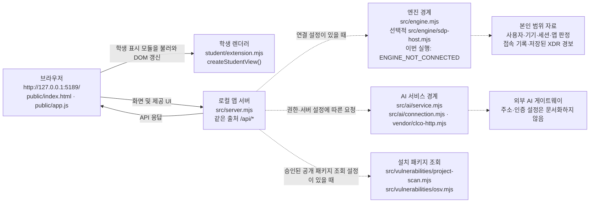

# PICASOAR 학생용 실행·구성 안내

이 문서는 기존 `docs/STUDENT_RUNBOOK.md`를 대체하지 않는 21단계 보충 안내입니다. 문서 최초 작성 당시에는 프로젝트 파일과 공식 학생 안내를 정적으로 대조했으며 앱을 실행하거나 연결을 시험하지 않았습니다. **이후 사용자가 제공한 실제 PC 실행 확인 결과를 §7에 추가했습니다.** 최초 작성 시점의 미확인 기록은 당시 사실로 유지하며, 현재 확인 상태는 실제 검증 기록과 구분해 읽어 주세요.

## 1. 목적과 범위

PICASOAR는 직원 본인의 로그인 사용자·기기·세션, 업무 앱 접근 판정, 본인 범위의 접속 기록 및 저장된 XDR 경보를 표시하는 학생용 보안 앱 프로젝트입니다. AI 사건 설명은 근거에 연결된 참고 정보이며, 접근 판정이나 보안 조치를 대신하지 않습니다. 조회할 자료가 없거나 연결되지 않았거나 확인에 실패한 상태를 정상·안전으로 간주하지 않습니다.

화면 이름과 앱 이름은 구분합니다. 기존 제공 문서와 시작 도구에는 기본 앱 이름 **케셰브(KESHEV)**가 남아 있으며, 사용자가 정한 Agent 이름 **PICASOAR**를 문서 제목에 사용해도 실행 중인 앱 제목이 자동으로 바뀌지는 않습니다.

## 2. 폴더 구조와 실행 환경

저장소 최상위 폴더와 앱 폴더는 다릅니다. 기존 프로젝트에서 다음 구조를 확인합니다.

```text
프로젝트 최상위 폴더/
└─ on-client/                  앱 작업 폴더
   ├─ package.json
   ├─ public/                   제공 브라우저 화면
   ├─ src/                      제공 로컬 서버와 서비스
   ├─ student/                  학생 표시 코드와 선택적 어댑터
   ├─ tools/start-alekov.ps1    Windows 실행 도구
   └─ docs/                     학생·구현 안내
```

`package.json`에서 읽은 프로젝트 계약과 실제 PC에서 확인한 항목은 다음과 같습니다.

| 항목 | 파일에서 확인한 값 | 실행 환경에서의 확인 |
|---|---|---|
| Node.js 기준 | `engines.node`는 `24.19.0` | 사용자가 확인한 설치 버전은 `v24.21.0`입니다. 이 버전에서 아래 `npm.cmd start` 실행 성공을 보고했습니다. 프로젝트 요구값과 설치 버전은 다르지만, 실제 확인된 실행은 성공했습니다. |
| npm | `package.json`에 별도 버전 고정 없음 | 사용자가 확인한 설치 버전은 `11.19.0`입니다. |
| 실행 도구의 허용 범위 | `tools/start-alekov.ps1`은 Node.js 주 버전 22~24를 허용하고, `v24.19.0`이 아니면 참고 메시지를 출력합니다. | 파일 존재는 확인됐지만 실제 스크립트 실행은 미확인입니다. |
| 패키지와 스크립트 | `alekov-client-starter` `0.2.11`; `start`는 `node src/server.mjs`, `demo`는 `node src/server.mjs --demo`, `check`는 `node --check student/extension.mjs` | 사용자는 `on-client` 폴더에서 `npm.cmd start` 실행 성공을 확인했습니다. `check`는 문법 확인용이지 화면·연결·공식 판정 검사가 아닙니다. |
| 의존성·lock 파일 | `package.json`에 `dependencies`가 선언되어 있지 않습니다. 파일 목록에서 `package-lock.json`은 확인되지 않았습니다. | 이 점검으로 별도 PC에 설치가 필요 없다고 보장하거나 `npm install`을 실행한 것은 아닙니다. 확인하지 않은 파일을 만들지 마세요. |
| 브라우저 주소 | 기본 로컬 주소 `http://127.0.0.1:5189/` | 사용자가 브라우저에서 루트 주소에 접속해 보호 현황 화면 표시를 확인했습니다. |
| 실행 위치와 방법 | 앱 폴더 `on-client`에서 실행 | 사용자는 `PICASOAR/on-client`에서 `npm.cmd start`를 실행했습니다. Git 최상위 폴더에서 실행하면 해당 위치에 `package.json`이 없어 `ENOENT`가 발생했다고 보고했습니다. |

키·토큰·비밀번호·개인 설정 파일의 내용은 코드, 문서, 도움정보, Git 또는 제출 자료에 넣지 않습니다. 문서에는 공개된 로컬 주소만 적고 외부 AI 게이트웨이 주소나 인증 설정값은 적지 않습니다.

## 3. 실행·종료·재실행

### 처음 실행

1. 기존 작업 파일을 보존합니다. 기존 프로젝트를 새로 만들거나 초기화하지 않습니다.
2. 파일 탐색기에서 기존 프로젝트의 `on-client` 폴더를 엽니다.
3. PowerShell 실행 위치가 앱 폴더인지 확인합니다. 프로젝트 최상위에서 PowerShell을 열었다면 다음으로 앱 폴더에 이동합니다.

   ```powershell
   Set-Location .\on-client
   ```

4. PowerShell의 실행 정책으로 `npm.ps1`이 차단되는 경우, 확인된 Windows 명령으로 `package.json`의 `start` 스크립트를 실행합니다.

   ```powershell
   npm.cmd start
   ```

   사용자가 실제로 확인한 위치는 `PICASOAR/on-client`이고 실행은 성공했습니다. 확인된 서버 출력은 다음과 같습니다.

   ```text
   케셰브 연결 확인: http://127.0.0.1:5189
   ```

5. 브라우저에서 `http://127.0.0.1:5189/`을 엽니다. 사용자는 보호 현황 화면이 표시되는 것을 확인했습니다. 실행 당시 기존 서버·에이전트 연결 상태는 `ENGINE_NOT_CONNECTED`였습니다. 따라서 로컬 화면 표시가 SDP·AI·OSV 또는 기존 서버·에이전트 연결 성공을 뜻하지 않습니다.

`tools/start-alekov.ps1` 파일은 존재하며 프로젝트에서 제공하는 실행 경로입니다. 그러나 이 PC에서 해당 스크립트 자체를 실제 실행한 결과는 확인되지 않았습니다. 파일 내용을 기준으로는 `on-client`에서 다음처럼 실행하도록 되어 있습니다.

```powershell
powershell -NoProfile -ExecutionPolicy Bypass -File .\tools\start-alekov.ps1
```

스크립트가 출력하도록 작성된 시작 문구는 `npm.cmd start`에서 실제로 본 출력과 다릅니다. 아래 문자열은 스크립트의 코드상 안내이며, 실제 스크립트 실행 결과로 확인한 것은 아닙니다.

```text
케셰브가 켜졌습니다. 브라우저에서 http://127.0.0.1:5189/ 을 여세요.
서버가 응답한 것만 확인했습니다. AI 연결 상태는 화면에서 따로 확인해 주세요.
```

PowerShell에서 `npm.ps1`이 실행 정책에 의해 차단되더라도, 사용자가 확인한 대안은 `on-client` 폴더에서 실행하는 `npm.cmd start`입니다. PowerShell 실행 정책을 변경하지 않았습니다. 기본 서버와 실행 도구 또는 `npm.cmd start`를 동시에 시작하지 않습니다. `npm run demo`는 예제 자료 화면용이며 실제 계정·기기·접근 판정·외부 연결 결과가 아닙니다. `npm run demo`는 실제 실행 확인하지 않았습니다.

`-NativeHostConfig` 또는 `-SdpHostConfig`는 담당자가 본인 프로젝트에 맞는 개인 설정을 별도로 발급·안내한 경우에만 그 안내를 따릅니다. 설정 경로를 임의로 만들거나 값을 문서에 복사하지 않습니다. SDP 연결과 예제 모드는 함께 사용할 수 없습니다.

### 종료와 재실행

실제 확인에서는 실행 중 PowerShell에서 `Ctrl+C`를 누르고 종료 확인 질문에 `Y`를 입력한 뒤 PowerShell 프롬프트로 돌아왔습니다. 재실행은 같은 기존 `on-client` 폴더에서 `npm.cmd start`를 다시 입력하고 브라우저 주소를 여는 절차입니다. 별도의 재실행 성공 여부는 확인하지 않았습니다.

### 다른 포트

제공 실행 도구는 기본 포트가 사용 중일 때 기존 프로그램을 임의 종료하지 않고 `-Port`로 다른 번호를 선택할 수 있도록 작성되어 있습니다. 예를 들어 다음과 같이 실행하면 브라우저 주소도 `http://127.0.0.1:5190/`으로 바꿉니다.

```powershell
powershell -NoProfile -ExecutionPolicy Bypass -File .\tools\start-alekov.ps1 -Port 5190
```

해당 스크립트 실행과 포트 충돌은 실제로 시험하지 않았습니다. `npm.cmd start`로는 이 문서에서 포트 옵션을 확인하지 않았으므로, 다른 포트가 필요할 때 제공 스크립트를 사용하려면 담당 안내와 실제 스크립트 실행 결과를 확인하세요.

## 4. 시스템 구성과 데이터 흐름



**글로 쓴 같은 구성:** 브라우저는 로컬 서버에서 `public/index.html`, `public/app.js` 및 화면 자원을 받습니다. 제공 UI는 같은 로컬 서버의 `/api/*`에 요청하고, 응답 자료를 학생 모듈 `student/extension.mjs`의 `createStudentView()` 렌더 함수에 전달해 학생 영역을 갱신합니다. `src/server.mjs`가 로컬 HTTP 서버와 API 경계를 구성합니다. `src/engine.mjs`의 기본 경로는 연결이 준비되지 않았을 수 있으며, `--demo`는 예제 엔진을 사용합니다. 담당자가 SDP 설정을 제공한 경우에만 SDP 경로를 사용할 수 있습니다. 이번 실행에서 사용자가 보고한 기존 서버·에이전트 연결은 `ENGINE_NOT_CONNECTED`였습니다. 이벤트 목록은 제공 서버가 읽은 본인 범위 자료이며 XDR 목록은 이미 저장된 경보이지 화면을 열 때 새로 탐지하는 결과가 아닙니다. AI와 취약점 조회는 각각 서버 측 서비스 경계를 거칩니다. 점선은 선택적·설정 의존 경로를 표시하며 실제 연결 성공을 의미하지 않습니다.

이 그림은 파일과 코드 경계를 바탕으로 한 구성도이며, 사용자가 확인한 로컬 화면 표시 및 `ENGINE_NOT_CONNECTED` 상태를 함께 적었습니다. 실제 네트워크 통신, AI 게이트웨이·SDP·OSV 외부 연결은 관찰하지 않았습니다.

## 5. 제공 코드와 학생 작성 코드

| 영역 | 경로 | 역할과 변경 경계 |
|---|---|---|
| 제공 브라우저 화면·요청 처리 | `public/index.html`, `public/app.js`, `public/style.css` | 메뉴, 폼, API 요청, 응답 계약 확인, 학생 렌더 호출 및 화면 연결을 담당합니다. 단계 안내에서 지정하지 않는 한 수정하지 않습니다. |
| 학생 화면 렌더링 | `student/extension.mjs`의 `createStudentView()` | 공식 단계 계약에 따라 각 `render…` 함수가 받은 자료를 표시하는 확장 지점입니다. 해당 단계에서 지정한 함수만 수정합니다. |
| 제공 서버·엔진 | `src/server.mjs`, `src/engine.mjs`, `src/engine/` | API·실행 모드와 접근 제어/SDP 연동 경계입니다. 실제 실행 결과로 보고된 기존 서버·에이전트 연결은 `ENGINE_NOT_CONNECTED`였습니다. |
| AI 서비스 | `src/ai/`, `src/connection/`, `vendor/clco-http.mjs` | AI 연결·권한·설명 요청의 서버 측 경계입니다. 실제 학생 계정 권한과 외부 모델 응답은 확인하지 않았습니다. |
| 취약점 서비스 | `src/vulnerabilities/`, `public/vulnerabilities-view.mjs` | 설치 정보 및 승인된 공개 패키지 조회 경계입니다. 미조회·실패는 취약점 없음이 아닙니다. 실제 OSV 조회 성공은 확인하지 않았습니다. |
| 조치 서비스 | `src/actions/` 및 학생 `renderAction` | 제안, 사람 확인, 서버 접수, 관측된 실제 효과를 구분합니다. ACK만으로 효과가 확인된 것은 아닙니다. 현재 자료의 `supportedActions`가 비어 있으면 조치 준비 경로가 나타나지 않는 것이 정상입니다. 실제 조치 실행은 확인하지 않았습니다. |

학생 렌더 함수와 단계별 입력 계약은 `docs/STUDENT_PROMPTS.md`를 기준으로 합니다.

| 단계·함수 | 주요 입력 계약 | 문서상 요구되는 구분 |
|---|---|---|
| 13 `renderIdentity` | `me`, `devices`, `sessions`; 각 자료의 `status`, `mode`, `data`, `error` | 사용자·현재 기기·세션, loading/error 및 연결 모드 |
| 14 `renderDecision` | `{ status, mode, data?, error?, appId }`; 판정 자료 `appId`, `decision`, `reason`, `checkedAt` | `idle/loading/ok/error`; allow/deny/challenge/unknown. 허용은 실제 앱 접속 성공 보장이 아닙니다. |
| 15 `renderEvents` | `{ status, mode, data?, error? }`; 기록 배열 | 접속 기록·저장된 XDR 경보, 필터, 근거·규칙·상태 상세. 본인 최근 40건 범위이지 전체 로그가 아닙니다. |
| 16 `renderStatus` | 기기·세션 자료, `notifications`, 전달된 `diagnostics`, `mode` | 빈 목록·오류·알림·진단을 구분합니다. 진단 API는 제공 화면이 조회하며 학생 함수가 직접 호출하지 않습니다. 세션 자료는 현재 검증된 연결 한 개 범위입니다. |
| 17 `renderAiConnection` | `{ status, mode, data?, error?, checkedAt, explanationAccepted }` | 연결 점검과 사건 설명을 구분합니다. 시험 점검(`test`)은 실제 권한 검증이 아닙니다. |
| 18 `renderExplanation` | `{ event, explanation, checkedAt }`; 설명 자료에는 summary, evidence IDs, proposals 등이 포함됩니다. | 선택한 기록의 근거·규칙·상태에 연결하고, 설명 실패·근거 불일치를 성공으로 표시하지 않습니다. 설명·제안만으로 조치가 실행되지 않습니다. |
| 19 `renderAction` | status, event, actionId, target, receipt, observation, message, confirmationExpiresAt, error | 준비·전달·접수·효과 관측을 구분합니다. `succeeded`여도 `observation.effectApplied === true`일 때만 효과 확인입니다. 실제 학생 계정의 집행 결과는 별도 환경 확인 대상입니다. |
| 20 `renderVulnerabilities` | `{ status, mode, data?, error? }`; 전체 조회 상태와 패키지 결과 | 공식 계약은 정확한 설치 버전·출처·시각, 전체 조회 상태와 패키지별 결과의 구분을 요구합니다. 실제 조회 결과 및 공식 단계 완료 여부는 확인하지 않았습니다. |

표는 단계별 입력 계약과 문서가 설명해야 할 경계를 요약합니다. 실제 브라우저에서 모든 상태가 동작하는지 확인했다는 의미는 아닙니다.

## 6. 오류별 확인 순서와 복구

오류가 나오면 해당 화면의 상태·오류 코드·메시지를 먼저 기록합니다. 설정 파일 원문이나 토큰·비밀번호·API 키는 공유하지 않습니다. 자동 재시도가 문서에 없는 경우 사용자가 임의로 반복 요청하지 않습니다.

| 상황 | 확인 위치 | 다음 단계 |
|---|---|---|
| Node.js 없음 또는 버전 안내 | PowerShell 창, `package.json`, `tools/start-alekov.ps1` | 프로젝트 계약은 Node.js `24.19.0`입니다. 사용자가 확인한 `v24.21.0`에서는 `npm.cmd start`가 성공했습니다. 실행 도구 자체는 이 PC에서 실행하지 않았으므로 그 스크립트의 버전 안내 결과는 미확인입니다. |
| 앱 폴더 오류 | PowerShell 현재 위치와 `on-client/tools/start-alekov.ps1` | `package.json`은 앱 폴더 `on-client`에 있습니다. 실제로 Git 최상위 폴더에서 실행했을 때 `package.json`을 찾지 못해 `ENOENT`가 발생했다고 보고됐습니다. 앱 폴더에서 명령을 실행합니다. |
| PowerShell에서 `npm.ps1` 차단 | PowerShell 실행 정책 안내 | 차단이 확인된 환경에서는 `on-client` 폴더에서 `npm.cmd start`를 사용합니다. 이 명령으로 실행 성공을 확인했으며 PowerShell 실행 정책 설정은 변경하지 않았습니다. |
| 제공 실행 스크립트 | `on-client/tools/start-alekov.ps1` | 파일 존재는 확인됐지만 실제 실행은 미확인입니다. 실행한다면 기존 프로젝트의 `on-client` 폴더에서 안내된 명령을 사용하고 결과를 별도로 확인합니다. |
| 포트 사용 중 | 실행 도구 메시지 | 기존 프로그램을 종료하지 말고 실행 도구의 `-Port`로 다른 포트를 지정한 뒤 그 포트의 `127.0.0.1` 주소를 엽니다. 실제 포트 충돌은 시험하지 않았습니다. |
| `ENGINE_NOT_CONNECTED` | 화면에 표시된 엔진 연결 상태 | 이번 실행에서 기존 서버·에이전트 연결 상태로 확인됐습니다. 이 값만으로 구체적 원인이나 설정 파일 발급 상태를 추측하지 않습니다. 연결이 필요한 경우 담당자에게 확인합니다. |
| `NATIVE_HOST_DISABLED` 또는 SDP 연결 자료 확인 불가 | 계정 연결 화면, 담당자가 안내한 `-NativeHostConfig` 또는 `-SdpHostConfig` 옵션 | 오류와 연결 종류를 구분해 담당자에게 확인합니다. 설정 파일을 만들거나 타인의 파일을 복사하지 않습니다. 로컬 보호 현황 화면 표시만으로 인증·SDP 연결을 성공으로 보지 않습니다. |
| AI 연결 점검 실패 | `renderAiConnection`에 전달된 코드·메시지 및 `docs/CONNECTION_TROUBLESHOOT.md` | 설정·응답 형식 관련 코드는 담당자에게 연결 설정을 확인합니다. 네트워크·시간 초과는 화면 안내에 따라 사용자가 직접 다시 점검합니다. 실제 AI 게이트웨이 연결은 확인하지 않았습니다. |
| AI 사건 설명 실패 | 보안 기록의 사건 설명 영역 | 기록은 그대로이며, 실패는 접근 판정 실패가 아닙니다. 필요하면 근거와 기록 선택을 확인하고 불필요한 유료 요청 반복은 하지 않습니다. 실제 설명 기능은 미확인입니다. |
| 취약점 결과 `not_configured`, `not_checked`, `partial`, `unverifiable` | 보호 현황의 패키지 조회 화면 | 이는 조회 설정 없음·미조회·일부 실패·확인 불가일 수 있으며 취약점 없음이 아닙니다. 승인 패키지 목록이나 의존성을 임의로 변경하지 말고 담당자에게 확인합니다. OSV 조회 성공은 미확인입니다. |
| 조치 준비가 보이지 않음 | 기록 상세의 `supportedActions`와 조치 영역 | 지원 조치가 없는 자료에서는 정상일 수 있습니다. 학생 화면에서 실제 조치를 추가하거나 요청하지 않습니다. 실제 보안 조치는 확인하지 않았습니다. |

장애 경로는 실행 도구, 학생 안내와 제공 오류 계약을 읽어 정리했습니다. 실제 확인으로 보고된 범위는 로컬 서버 시작·보호 현황 화면 표시·`ENGINE_NOT_CONNECTED` 및 종료이며, 그 밖의 연결 실패 경로는 재현하거나 복구하지 않았습니다.

## 7. 실제 PC 확인 결과와 미확인 범위

다음은 사용자가 실제 PC에서 확인한 결과를 전달해 문서에 반영한 것입니다. 이 환경에서 제가 PC 명령이나 브라우저를 직접 조작한 결과는 아닙니다.

### 확인된 결과

- 설치 버전: Node.js `v24.21.0`, npm `11.19.0`.
- 요구 버전: `on-client/package.json`의 Node.js `24.19.0`.
- 작업 위치: `PICASOAR/on-client`.
- 실행: `npm.cmd start` 성공. 서버 출력은 `케셰브 연결 확인: http://127.0.0.1:5189`.
- 브라우저: `http://127.0.0.1:5189/` 접속 후 보호 현황 화면 표시 확인.
- 연결 상태: 기존 서버·에이전트 `ENGINE_NOT_CONNECTED`.
- 종료: 실행 중 `Ctrl+C`, 종료 확인 질문에 `Y` 입력 후 PowerShell 프롬프트 복귀.
- 셸 차이: PowerShell의 `npm.ps1` 실행은 정책에 의해 차단됐고 `npm.cmd`로 우회 실행.
- 위치 오류: Git 최상위 폴더에서 실행했을 때 해당 폴더에서 `package.json`을 찾지 못해 `ENOENT` 발생.
- 실행 스크립트: `tools/start-alekov.ps1` 파일 존재 확인. 실제 실행 성공은 확인하지 않음.

### 미확인 범위

- `tools/start-alekov.ps1` 실행 성공, `npm run demo` 및 `npm run check` 실행.
- 재실행 성공, 포트 충돌·다른 포트 실행.
- 브라우저에서 보호 현황 외 모든 메뉴·버튼, 키보드 조작, 단계별 화면 상태와 새로고침 교체.
- 기존 서버·에이전트 연결 복구, Native Host/SDP 인증 연결.
- AI 게이트웨이 연결, 실제 계정 권한, AI 모델 호출.
- 실제 보안 조치 실행 및 OSV 취약점 조회 성공.
- 문법 검사·테스트 실행과 공식 21단계 AI 판정·통과 여부.

확인되지 않은 기능은 통과나 성공으로 간주하지 않습니다. 사용 가능한 기능의 추가 검증은 기존 작업을 보존한 채 필요한 항목만 직접 진행하고, 연결·권한·유료 요청·실제 조치가 필요한 검증은 임의로 반복하지 않습니다.

## 8. 21·22단계 커밋과 비공개 원문 제출

문서와 이번 단계의 변경 코드는 제출 대상이 될 **같은 커밋**에 포함해야 합니다. 커밋 전에 프로젝트 최상위 폴더에서 기존 변경을 먼저 확인하고, 본인 작업을 보존합니다. 아래는 변경 상태를 읽기 위한 예시이며 실행하지 않았습니다.

```powershell
git status --short
git diff -- on-client/docs/STUDENT_SYSTEM_GUIDE.md
```

21·22단계는 현재 안내상 워크벤치의 「포털 제출 준비」(13~20단계 지원)에 의존하지 않고, 과제 화면에 저장소 주소와 40자리 커밋을 직접 입력하는 흐름입니다. 비공개 저장소를 공개로 바꿀 필요는 없습니다.

비공개 저장소라면 과제 화면에서 **「비공개 저장소 원문 준비 방법」**을 펼치고 다음 순서를 따릅니다.

1. 「원문 전달 도구 받기」를 누릅니다. ZIP은 프로젝트 폴더 밖에 풉니다. JSON을 저장할 새 폴더도 프로젝트 폴더 밖에 만듭니다.
2. 제출할 프로젝트의 Git 최상위 폴더에서 PowerShell을 엽니다. 과제 화면이 제시한 `student-source-cli.mjs`의 실제 위치, 옵션, 출력 파일 경로를 읽고 본인 PC에 맞게 사용합니다. `--commit` 뒤에는 실제 제출 대상인 40자리 커밋을 지정합니다.
3. 명령의 구체적인 인자·경로는 이 문서에서 추측해 만들지 않습니다. 현재 과제 화면의 명령을 사용하고, 실제 프로젝트 경로와 40자리 커밋을 확인한 뒤 실행합니다. 도구가 커밋된 원문만 묶고 코드를 실행하거나 업로드하지 않는다는 안내도 화면에서 확인합니다.
4. 생성한 JSON을 같은 단계의 「비공개 저장소 원문 묶음」에서 선택합니다. 저장소·커밋·단계를 대조한 뒤 제출합니다.
5. 원문 전달 완료는 AI 검토 통과와 다릅니다. 서버의 상태와 판정 설명을 각각 확인합니다. 원문 전달만 실패한 경우 기존 접수를 유지하고 해당 화면의 「원문만 다시 보내기」 절차를 따릅니다.

이 환경에서는 사용자의 실제 프로젝트 절대 경로, 제출할 40자리 커밋, 과제 화면의 도구 ZIP 위치·JSON 경로·정확한 CLI 옵션을 확인할 수 없습니다. 따라서 실제 명령을 만들거나 커밋·Push·제출을 수행하지 않았습니다. 비밀값을 문서에 넣지 말고, 최종 안내는 현재 과제 화면의 명령과 본인 경로를 확인한 뒤 작성합니다.
